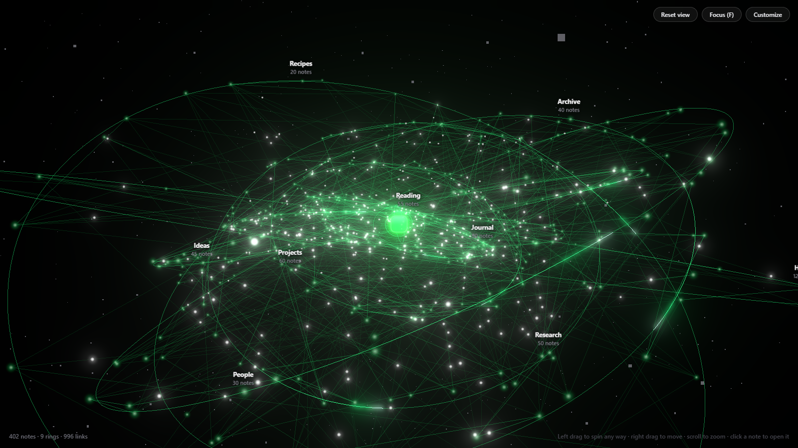

# Nebula

A glowing 3D constellation view of your Obsidian vault.



Every note is a star. A living star burns at the centre, each top-level folder gets its own tilted orbit ring around it inside faint nebula gas, and every link between notes is drawn as a line of light, with beads of light running along it.

## Features

- Full 3D view: drag to spin, right-drag to move, scroll to zoom.
- Click a star to open that note in a split pane. Hover to see its name and folder.
- Click a folder label to fly to that ring.
- Focus mode (`F`) hides the sidebars so the view fills the window. `Esc` leaves it.
- Customize panel: color, glow, node size, link and ring brightness, light beads, spin, comets, pulse, twinkling background stars, nebula clouds, folder names, motion, and render quality.
- The view updates itself when notes or links change.
- The ribbon's orbit button switches between Nebula and the normal graph view.

## Install

### With BRAT (works today)

1. Install **BRAT** from Settings → Community plugins → Browse, and enable it.
2. Run the command **BRAT: Add a beta plugin for testing**.
3. Paste `7evyr/obsidian-nebula` and confirm.
4. Enable **Nebula** in Settings → Community plugins.

### By hand

1. Download `nebula.zip` from the [latest release](https://github.com/7evyr/obsidian-nebula/releases/latest).
2. Unzip it into `<your vault>/.obsidian/plugins/`, so you end up with `.obsidian/plugins/nebula/main.js`, `manifest.json` and `styles.css`.
3. Reload Obsidian and enable **Nebula** in Settings → Community plugins.

Do not use the green **Code → Download ZIP** button. That is the source code and has no `main.js`, so Obsidian cannot load it.

## Troubleshooting

- **The tab is blank or shows an error on Obsidian 1.15.** Update to 0.1.4 or later (BRAT: run **BRAT: Check for updates**).
- **It does not spin.** Your system asks apps to reduce motion (Windows: Settings → Accessibility → Visual effects → Animation effects; macOS: Reduce motion). Nebula follows that by default. To animate anyway, open **Customize** and set **Motion** to **On**.
- **"Nebula could not start".** Nebula needs WebGL. Turn on Settings → Appearance → Hardware acceleration and restart Obsidian.
- **Hidden `.obsidian` folder.** On macOS press `Cmd+Shift+.` in Finder. On Windows turn on View → Show → Hidden items.

## Use

Click the orbit icon in the left ribbon, or run **Nebula: Toggle view** from the command palette.

## Notes

- Desktop only for now.
- Big vaults are fine. If it feels heavy, set Quality to **Fast** in the Customize panel.
- Nebula only reads your vault's file list and links. It never changes your notes and makes no network requests.

## Build

```bash
npm install
npm run build
```

This writes `main.js` next to `manifest.json` and `styles.css`.

## License

[MIT](LICENSE). Built with [three.js](https://threejs.org) (MIT).
